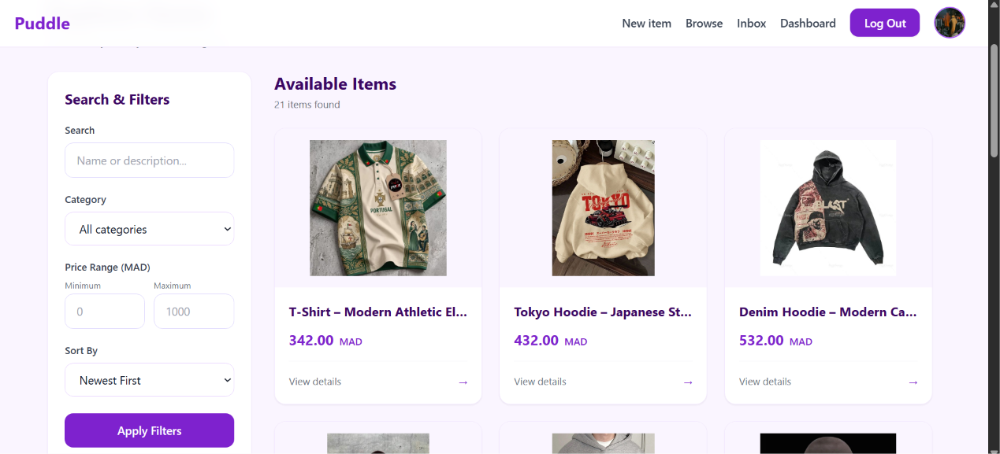
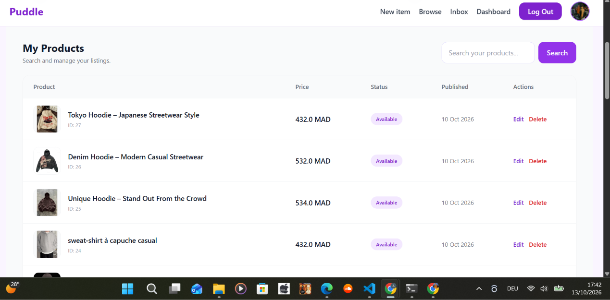
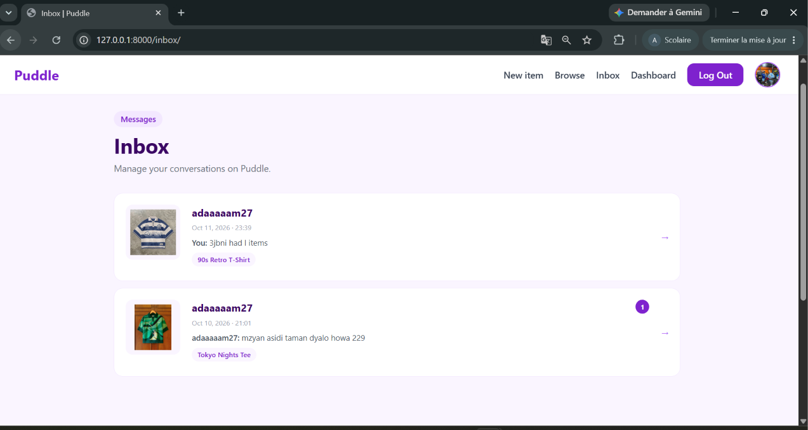
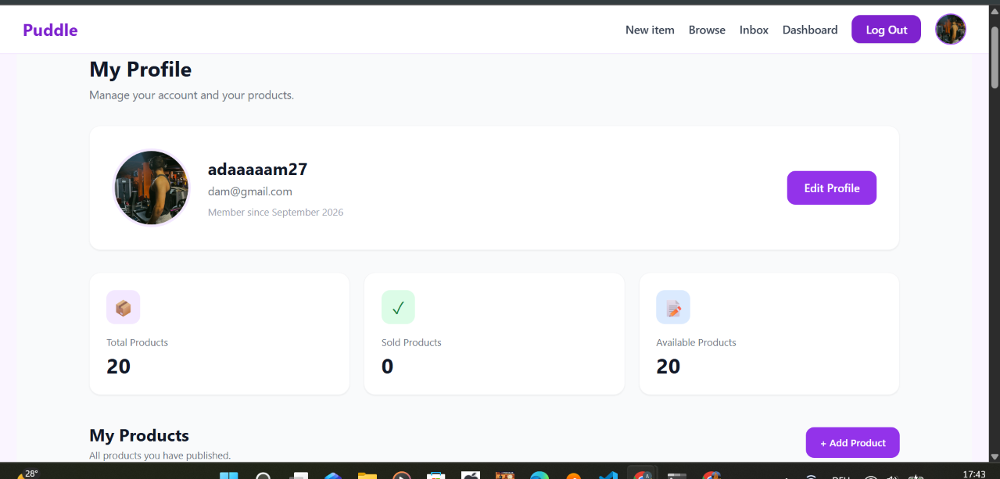

# Puddle — Online Marketplace

Puddle is a full-stack online marketplace built with Django. It allows users to discover products, publish their own items, and communicate with sellers through a built-in messaging system.

## Features

* **User Authentication** — Sign up, log in, and log out.
* **Product Listings** — Create and publish products with images, descriptions, prices, and categories.
* **Browse Products** — Search products and filter them by category.
* **Product Details** — View product information and discover related items.
* **Seller Dashboard** — Manage your published products.
* **Messaging System** — Communicate directly with sellers through conversations and an inbox.
* **Responsive UI** — Styled with Tailwind CSS.
* **Image Storage** — Support for product and profile images.

## Screenshots

### Homepage


### Browse Products



### Product Details


### Seller Dashboard


### Seller Dashboard — Additional View



### Inbox and Messaging



### User Profile



## Tech Stack

| Technology          | Purpose                       |
| ------------------- | ----------------------------- |
| Python              | Backend programming           |
| Django              | Web framework                 |
| HTML                | Page structure                |
| Tailwind CSS        | Styling and responsive design |
| JavaScript          | Frontend interactions         |
| SQLite / PostgreSQL | Database                      |
| Git & GitHub        | Version control               |

## Project Structure

```text
puddle/
├── core/             # Main pages and user authentication
├── item/             # Product listings and categories
├── conversation/     # Messaging system
├── puddle/           # Project settings and URL configuration
├── media/            # Uploaded media files (local development)
├── manage.py
├── requirements.txt
├── .gitignore
└── README.md
```

## Getting Started

### 1. Clone the repository

```bash
git clone https://github.com/adamelaouane/puddle.git
cd puddle
```

### 2. Create a virtual environment

```bash
py -3.11 -m venv env
```

### 3. Activate the environment

**Windows:**

```powershell
.\env\Scripts\Activate.ps1
```

### 4. Install dependencies

```bash
pip install -r requirements.txt
```

### 5. Apply database migrations

```bash
python manage.py migrate
```

### 6. Start the development server

```bash
python manage.py runserver
```

Open `http://127.0.0.1:8000/` in your browser.

## Future Improvements

* Improve the shopping and browsing experience.
* Add product reviews and ratings.
* Enhance messaging features.
* Add more advanced search and filtering options.

## Author

**Adam Elaouane**

GitHub: [@adamelaouane](https://github.com/adamelaouane)
