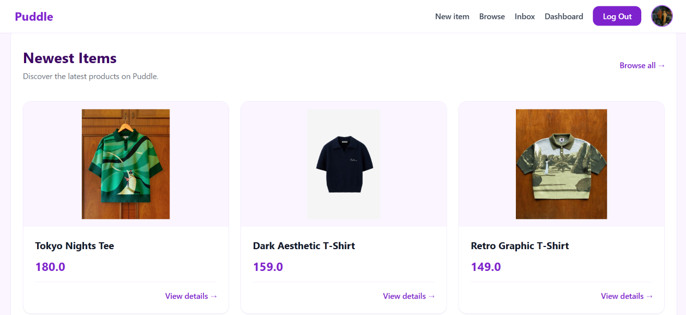
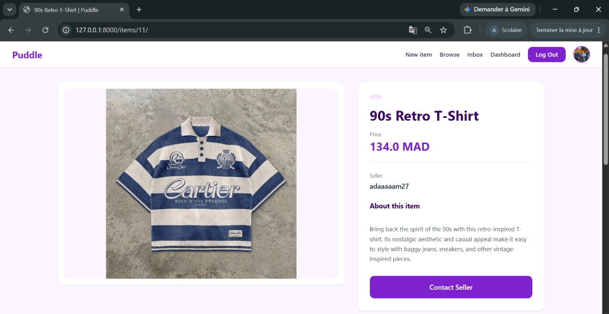
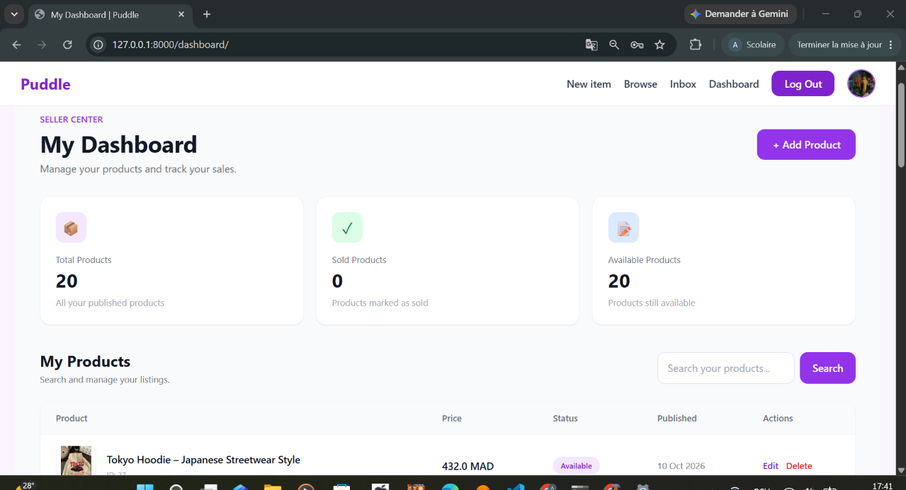

# Puddle — Online Marketplace

A full-stack marketplace web application built with Django, where users can discover products, publish listings, and communicate with sellers.

## Overview

Puddle is a web application designed to provide a simple marketplace experience. Users can browse available products, search listings, explore categories, publish their own items, and contact sellers through an integrated messaging system.

This project was built to develop practical skills in backend development, database management, authentication, and responsive web interfaces.

## Features

* **User Authentication** — User registration, login, and logout.
* **Product Listings** — Create and publish product listings with descriptions, prices, and images.
* **Product Search** — Search products by name and description.
* **Category Filtering** — Browse products by category.
* **Product Details** — View product information and related items.
* **Seller Dashboard** — Manage personal listings.
* **Messaging System** — Conversations between buyers and sellers.
* **Image Storage** — Cloudinary integration for image storage.
* **Database Integration** — SQLite for local development and PostgreSQL support.
* **Responsive UI** — Interface styled with Tailwind CSS.

## Screenshots

<!-- Add screenshots to the screenshots/ directory and uncomment these lines. -->

<!--
### Homepage


### Product Details


### Seller Dashboard


### Messaging

-->

## Tech Stack

| Technology          | Purpose                       |
| ------------------- | ----------------------------- |
| Python              | Programming language          |
| Django              | Backend web framework         |
| Django ORM          | Database operations           |
| SQLite / PostgreSQL | Data persistence              |
| HTML                | Page structure                |
| Tailwind CSS        | Styling and responsive design |
| Cloudinary          | Image storage                 |
| WhiteNoise          | Static file serving           |
| Git & GitHub        | Version control               |

## Project Structure

```text
puddle/
├── puddle/          # Project configuration and root URLs
├── core/            # Main pages and shared functionality
├── dashboard/       # User dashboard
├── item/            # Product listings, categories and search
├── conversation/    # Buyer-seller messaging
├── manage.py
├── requirements.txt
└── README.md
```

## Getting Started

### Prerequisites

* Python 3.11+
* Git
* Cloudinary credentials for image uploads
* A PostgreSQL connection string if using PostgreSQL

### 1. Clone the repository

```bash
git clone https://github.com/adamelaouane/puddle.git
cd puddle
```

### 2. Create a virtual environment

**Windows PowerShell:**

```powershell
py -3.11 -m venv env
.\env\Scripts\Activate.ps1
```

### 3. Install dependencies

```bash
python -m pip install -r requirements.txt
```

### 4. Configure environment variables

Set your own values in PowerShell. Never publish real credentials.

```powershell
$env:DEBUG = "True"
$env:DJANGO_SECRET_KEY = "replace-with-a-local-development-secret"
$env:CLOUDINARY_CLOUD_NAME = "your-cloud-name"
$env:CLOUDINARY_API_KEY = "your-api-key"
$env:CLOUDINARY_API_SECRET = "your-api-secret"
```

If you want to use PostgreSQL, configure `DATABASE_URL` with your own connection string. Otherwise, the project can use SQLite if the settings are configured for that fallback.

### 5. Apply database migrations

```bash
python manage.py migrate
```

### 6. Create an administrator account

```bash
python manage.py createsuperuser
```

### 7. Run the development server

```bash
python manage.py runserver
```

Open http://127.0.0.1:8000/ in your browser.

## Configuration Notes

* Configure environment variables again when opening a new terminal session, unless you use a persistent environment configuration.
* PostgreSQL can be used for hosted database persistence.
* Cloudinary credentials are required for uploads when Cloudinary storage is enabled.
* Production deployment requires suitable secret-key, host, database, and static-file settings.

## Future Improvements

* Add automated tests for core features.
* Improve product filtering and sorting.
* Add pagination for product listings.
* Enhance form validation and error handling.
* Deploy the application and document the live demo.

## Author

**Adam Elaouane**

Computer Science Student | Aspiring Full-Stack Developer

GitHub: [@adamelaouane](https://github.com/adamelaouane)

---

*Built as a hands-on project to practice Django development, database integration, authentication, and full-stack web application design.*
